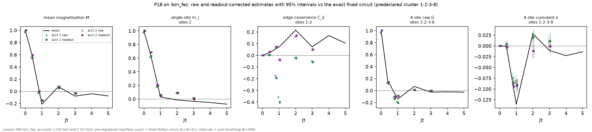
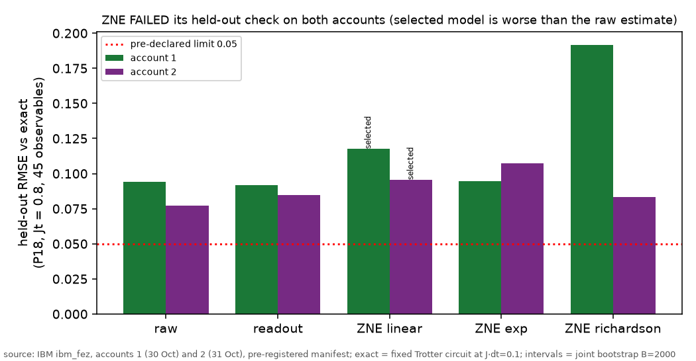
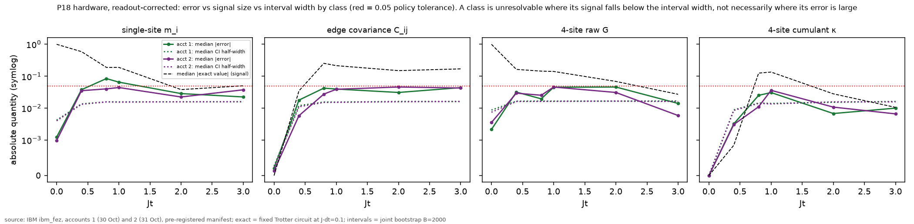
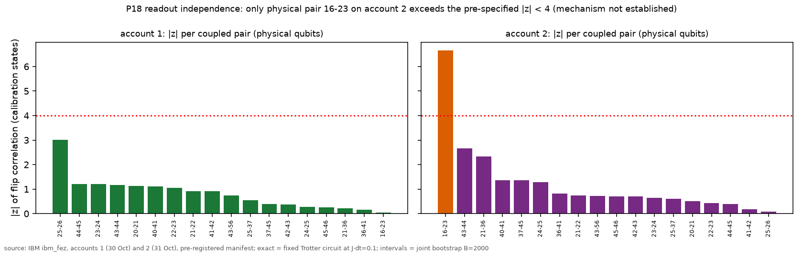
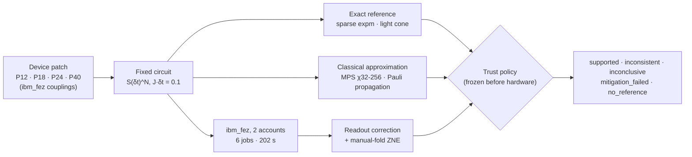
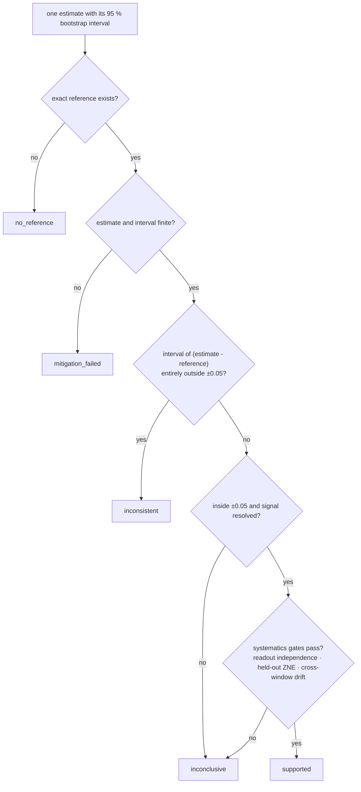
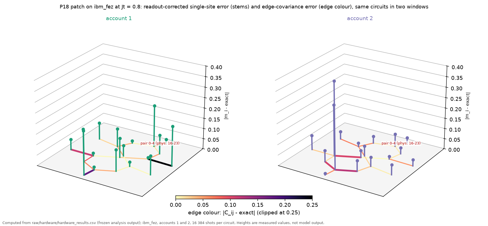
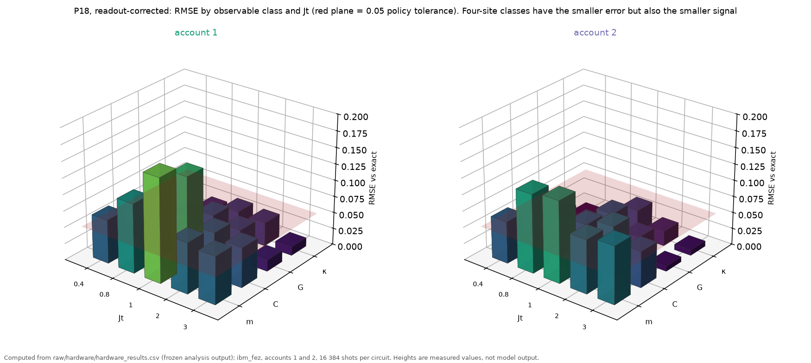
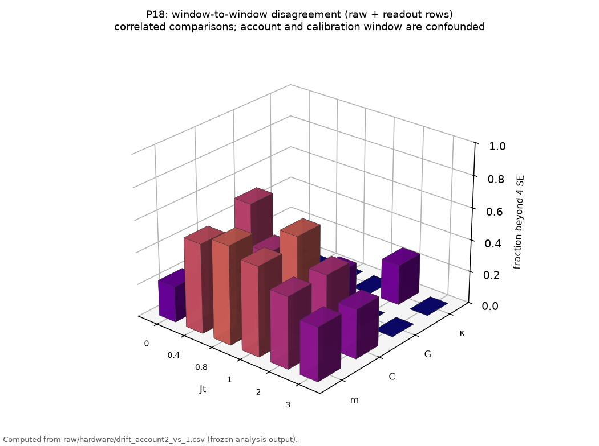
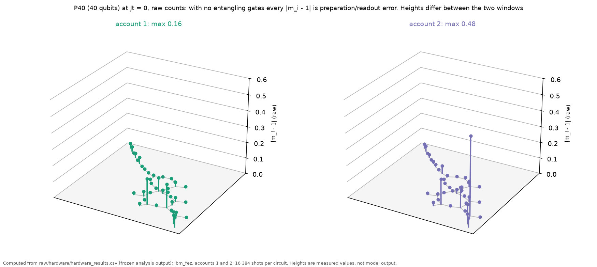

# qtrust: When can we trust a quantum simulation?

**TEAM-NWCZYG** · BITS Pilani Goa × IBM Qiskit Fall Fest 2026 · Advanced track, Problem B

We simulate Trotterised mixed-field Ising dynamics on connected patches of IBM's heavy-hex `ibm_fez` (12, 18, 24 and 40 qubits) and ask a narrow, practical question:
**for which statistics (1-, 2- and 4-site) and at which times can the answer be trusted, and which check tells us so?**
A useful result is an honest boundary of reliable computation, so negative results are reported as measured. **No quantum advantage is claimed.**

```
H = -J Σ_E Z_i Z_j - Σ_i (h_x X_i + h_z Z_i)      J = 1, h_x = 1.25, h_z = -0.60, start |0…0⟩
U_N = S(δt)^N,  S = F(δt/2) B(δt) F(δt/2)           second-order split, frozen J·δt = 0.1
```

> **Status (31 Oct 2026).** Final. Hardware ran on two independent IBM accounts about 20 h apart under a pre-registration (sha `5360308738170cc5410562cb971a3050`) with a typed, hash-tied two-person approval.
> All six job ids were looked up on IBM by the account owners (read-only `verify-jobs`): status DONE on `ibm_fez`, usage as archived. Simulated results are labelled `simulated_noisy` and can never be `supported`.

## Results at a glance

| | |
|---|---|
| Hardware | `ibm_fez`, 2 accounts, **6 jobs, 56 circuit executions, 720 896 shots, 202 s** of reported QPU time (limit 600 s) |
| Circuit validation | Trotter error ≤ 0.014 (P12/P18); circuit = Aer = independent numpy kernel to 2e-15 |
| Max compiled two-qubit depth | 150 (ceiling 300) |
| Exports | `results.csv` 15 108 rows (4 230 hardware) · `resources.csv` 121 rows · `metadata.json` 18 keys |

| Question | Answer on this device, in these two windows, with our 0.05 tolerance |
|---|---|
| Does zero-noise extrapolation help? | **No.** It failed its pre-declared held-out check on both accounts: selected linear model RMSE **0.118 / 0.096** vs raw **0.094 / 0.077** (limit 0.05). |
| Is readout correction trustworthy? | Mostly. Account 2 **violates the independence assumption** at one physical pair (16-23, z = +6.66 vs limit 4); the cause is not established. |
| Is the device stable between windows? | No. 650 of 2 115 matched estimates differ by more than 4 shot-noise SEs (correlated comparisons, so not 650 independent failures; account and calibration window are confounded). |
| Classical approximation or hardware noise? | 18 qubits: **hardware noise** is the binding limit (MPS χ256 within 0.017 of exact to Jt 5). 40 qubits: neither is validated beyond Jt = 0.5. |
| Do 4-site statistics fail first? | Not in accuracy. They become **unresolvable** earlier (κ signal 0.001-0.03 vs interval half-width 0.015). A predictor that always answers 0 is competitive for κ, so agreement fractions are not fidelity. |

Estimator health: 69 of 4 230 hardware estimates are non-finite and 30 more lack an interval, all exponential-ZNE fits; shown separately from "no reference" in `reports/ESTIMATOR_HEALTH.md`.

<p align="center">
  
  
</p>
<p align="center">
  
  
</p>

**Where to read next:** `reports/FINAL_SCIENTIFIC_REPORT.md` (start here) · `reports/SUBMISSION_COMPLIANCE.md` (requirement-by-requirement evidence) · `reports/LIMITATIONS.md` · `reports/REPRODUCIBILITY.md` · `reports/HARDWARE_PROVENANCE.md` · `reports/ESTIMATOR_HEALTH.md` · `reports/findings.md`.

## How it works



**How a verdict is decided** (`src/qtrust/trust.py`, thresholds in `configs/trust_policy.yaml`, fixed before any hardware data):



Simulated data can never reach `supported`. "No reference" and "estimator failed" are separate axes (`reports/ESTIMATOR_HEALTH.md`).

## 3-D views of the hardware data
All heights are measured values from `raw/hardware/hardware_results.csv`; nothing is modelled. Regenerate with `python scripts/reproduce_all.py`.

**P18 patch on `ibm_fez`, Jt = 0.8.** Each stem stands on a qubit of the real heavy-hex patch and its height is the single-site error after readout correction; edge colour is the edge-covariance error. The same circuits in the two windows give visibly different error landscapes.



**Error by observable class and time.** The red plane is the 0.05 tolerance. Four-site classes (G, κ) have the smaller error but also the smaller signal, which is why they become unresolvable first.



**Window-to-window disagreement.** The fraction of matched estimates beyond 4 shot-noise SEs (correlated comparisons; account and calibration window are confounded).

<p align="center"></p>

**P40 at Jt = 0 (no entangling gates).** Any deviation from m = 1 here is preparation or readout error. Account 2's largest is 0.48 against 0.16 for account 1.



## Team

| member | QFF registration ID | email |
|---|---|---|
| Kushagra Singh (team leader) | QFF-D63728 | offkushagrasingh47@gmail.com |
| Krutiksinh Narendrasinh Rana | QFF-591869 | Knrana08@gmail.com |

GitHub accounts that committed to this repository: `LuciferK47` (repository owner), `Krut27`.

## What is the quantum-computing component?
The object under study is a Trotterised quantum many-body circuit (mixed-field Ising model on IBM heavy-hex qubit patches), run on a real IBM Quantum backend. The project compares, for the same fixed circuit:
exact references (sparse `expm`, light-cone exact), classical approximations (MPS, sparse Pauli propagation), noisy simulation, and hardware with readout correction and zero-noise extrapolation,
and combines the checks into a multi-gate **trust verdict** per estimate (`supported` / `inconsistent` / `inconclusive` / `mitigation_failed` / `no_reference`), with joint-bootstrap 95 % intervals.

## Method in brief
1. **Fix the graph and circuit.** Connected patches P12/P18/P24/P40 of the `ibm_fez` coupling map, all couplings kept, open boundaries. J·δt = 0.2 missed the 0.02 accuracy target, so **0.1 was frozen** (0.2 kept as exploratory).
2. **Validate against exact numerics.** Sign, bit-order, t = 0, reversal and mutation checks; hz-reversal contrast on P12 up to 0.71; level statistics ⟨r⟩ = 0.52.
3. **Classical approximation.** MPS (χ 32-256) and Pauli propagation under a hard 1 200 s limit with whole-process memory sampling; timeouts reported, not hidden.
4. **Hardware.** Same 28-circuit manifest on two accounts: structured readout calibration, forward circuits (P18 up to Jt 3, P40 up to Jt 3), manual global-fold ZNE at 1x/3x/5x (nominal gate-count factors; effective noise scaling was **not** measured), SamplerV2 Batch, no twirling or PEA with fractional gates.
5. **Trust policy.** A verdict needs a reference, a finite estimate, a resolved signal, agreement within 0.05 and passing systematics gates (readout, held-out ZNE, cross-account drift). Thresholds were fixed before any hardware data.

## Pre-existing versus hackathon work
- **Written during the hackathon (29-31 Oct 2026), by the team with AI assistance (Claude):** everything under `src/`, `tests/`, `scripts/`, `configs/`, `reports/`, plus the saved results in `raw/`, `figures/` and the exported `results.csv`, `resources.csv`, `metadata.json`. No source code in this repository pre-dates the hackathon.
- **Third-party, used under their licences, not modified:** Qiskit, Qiskit Aer, qiskit-ibm-runtime (incl. `FoldRzzAngle`, `FakeFez`), `pauli-prop` (IBM), `quimb`, numpy, scipy, pandas, networkx, matplotlib, pytest (pinned in `requirements.lock`).
- **Provided by the organisers:** the problem statement (Problem B) and the offline `FakeFez` backend snapshot shipped with qiskit-ibm-runtime.

## Setup and reproduction (Python 3.12, no IBM account needed)
```bash
uv venv --python 3.12 .venv
VIRTUAL_ENV=.venv uv pip sync requirements.lock      # pinned, binary wheels only
VIRTUAL_ENV=.venv uv pip install -e .
.venv/bin/python -m pytest                           # all tests are offline
.venv/bin/python scripts/reproduce_all.py            # results.csv, resources.csv, metadata.json and every figure from saved data
```
Windows (PowerShell): `py -3.12 -m venv .venv; .\.venv\Scripts\Activate.ps1; python -m pip install -r requirements.lock; python -m pip install -e .`
`mthree` was dropped: 2.8.1 imports `BackendV1`, which Qiskit 2.x removed. Readout correction is implemented in `src/qtrust/mitigation.py` and unit-tested against explicit assignment-matrix inversion.

<details>
<summary><b>All commands</b></summary>

Offline:

| command | what it does |
|---|---|
| `python -m qtrust.cli patches` | build P12/P18/P24/P40 from the FakeFez snapshot, save JSON + drawings |
| `python scripts/run_classical.py PID --budget 1200 [--pauli ...] [--chi ...] [--Ns ...] [--ref-Ns ...]` | supervised Pauli-propagation and MPS benchmark vs exact |
| `python -m qtrust.cli exact --patches P12,P18 [--halving]` | exact fixed-circuit tables, Trotter-error and Aer checks at the frozen dt |
| `python -m qtrust.cli rehearsal --patch P12` | noisy-Aer rehearsal: readout correction + ZNE (held-out) + bootstrap + trust status |
| `python -m qtrust.cli manifest` | compile every planned hardware circuit, ISA/depth gates, usage estimate (**dry run**) |
| `python scripts/reproduce_all.py` | regenerate `results.csv`, `resources.csv`, `metadata.json` and every figure |
| `python -m qtrust.cli analyse-hardware --accounts 1,2 --B 2000` | pre-registered hardware analysis from the raw counts (about an hour) |
| `python -c "from qtrust import hwanalysis as H; H.run_all()"` | post-hoc diagnostics: readout independence, class table, held-out ZNE, drift, estimator bias |
| `python scripts/build_zip.py` · `scripts/verify_release.sh dist/TEAM-NWCZYG.zip` | build the archive and check it in a clean environment |

Contact IBM Quantum (run by a human, only after the approval gate below): `preregister`, `live-check --account N`, `submit --account N --job {1_pilot,2_forward,3_zne}`, `fetch --account N`, and the read-only `verify-jobs --account N`.
</details>

## Repository layout
| path | content |
|---|---|
| `src/qtrust/` | `graph`, `circuits`, `exact`, `moments` (two independent κ formulas), `classical/{pauli,mps,bench}`, `mitigation`, `bootstrap`, `trust`, `hardware`/`manifest`, `rehearsal`, `submit` (gated), `hwdata`, `hwanalysis`, `verify`, `figures`, `validate` |
| `configs/` | `trust_policy.yaml` (written **before** any hardware data), `heavy_hex.yaml` |
| `raw/` | exact references, classical runs, noisy simulation, and `raw/hardware/` (lossless counts, compiled QPY circuits, live checks, job records) |
| `prereg/` | pre-registration and the typed approval |
| `reports/` | final report, compliance, limitations, provenance, reproducibility, estimator health, CSV tables |
| `tests/` | 192 offline tests, including frozen-evidence hash checks |
| `results.csv` · `resources.csv` · `metadata.json` | the required exports (hardware included) |
| `TEAM-NWCZYG.zip` | the submission archive (also attached to the GitHub Release `final-submission`) |

## What is verified (see `tests/`)
* Field unitary exact for **both signs of h_x and h_z**; bond sign `RZZ(-2Jδt)` checked against `expm`; wrong signs are detected.
* Circuit statevector = independent numpy kernel = Aer; merged field halves = unmerged `S^N`; `U†U|0⟩=|0⟩`; `N=0` is the identity with `m=G=1, C=κ=0`.
* Qiskit little-endian bit order checked with an `X` on qubit 3 only; compiled classical-bit map is `clbit i ← physical nodes[i]`.
* κ from raw moments (all **15** subsets incl. triples) = the PDF's central-product definition = direct enumeration; a test shows the "no triples" shortcut is wrong when means ≠ 0.
* The suite was mutation-checked: flipping the bond sign, field angle, dropping `h_z`, reversing bit order, or dropping triple moments each makes tests fail.
* Light-cone exact references equal the full exact solver (≤ 2e-14); Pauli propagation is exact when untruncated; MPS is exact for large χ.
* Readout correction is exact for independent readout noise and is never clipped; manual ZNE folds survive compilation only because of barriers (a control test shows they cancel without them).
* Every compiled circuit: RZZ angles in (0, π/2], only the patch's own couplings, no SWAPs.
* Frozen evidence: every raw hardware file and the pre-registration are SHA-256 hashed (`reports/evidence_hashes.csv`, plus `reports/job_verification_hashes.csv` for the post-run IBM verification files); a test fails if any changes.

## QPU approval gate
`manifest` only compiles and estimates. Submission lives in `src/qtrust/submit.py` and is never run automatically; `submit` refuses unless:
1. `preregister` has hashed the policy, configs, analysis code and planned circuits, and nothing has changed since;
2. `prereg/APPROVAL.md` carries that sha, two different approver names and a date (the organisers said the mentor reviews after screening, so this pre-registration with typed approval is our pre-hardware gate; it is typed consent tied to a hash, not a cryptographic signature);
3. the account has a passing `live-check` (credentials saved by the user with `QiskitRuntimeService.save_account`, never in code, logs or the archive; `ibm_fez` must expose fractional gates);
4. the pilot job was submitted and fetched first, and the job fits the per-account cap using the measured `job.usage()`.

Account 2 repeats the identical manifest in a later calibration window as a drift check.

## Limitations (short form; full list in `reports/LIMITATIONS.md`)
ZNE failed on these windows; one readout pair broke the independence assumption in window 2; drift between windows is large and its cause is not isolated; intervals contain shot noise and calibration resampling only;
P40 is an elongated patch (40 qubits, 41 couplings, 2 cycles) with an exact reference only to Jt 0.5, and hardware references exist only at Jt 0 and 0.4; the 0.05 hardware and 0.02 classical tolerances are team policy choices;
classical timings are for one laptop CPU; the optional disturbance-spreading extension was **not done**; IBM's job records confirm status, backend and usage, not the measurement counts themselves.

## Reused packages and AI assistance
Qiskit, Qiskit Aer, qiskit-ibm-runtime (FoldRzzAngle, FakeFez), `pauli-prop` (IBM), `quimb`, numpy/scipy/pandas/networkx/matplotlib.

**AI use disclosure.** An AI assistant (Claude) was used for implementation work: code, tests.
After that first implementation, the authors directed the changes that followed (for example freezing J·δt = 0.1, the pre-registration and two-person approval gate, the two-account hardware plan and the choice of what to submit). The authors chose the problem setup
and the policies, ran every hardware job themselves on their own IBM accounts, gave the typed, hash-tied pre-hardware approval, and are responsible for the submission. Every check listed above is a test in `tests/` that can be re-run (`pytest`).

**Review and corrections.** Earlier versions were audited several times; the audits found real problems (for example NaN mitigation estimates receiving trust verdicts, classical benchmarks at a different time step than the hardware plan, hardware missing from the exports, an incomplete evidence ledger).
Each finding was fixed, re-tested and documented in `reports/audit_response.md`.
